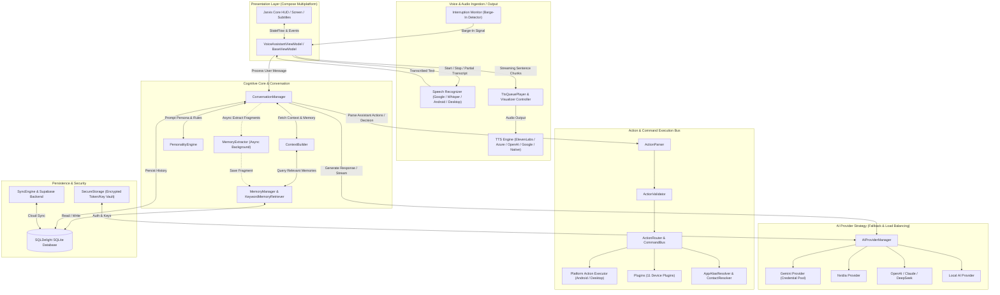
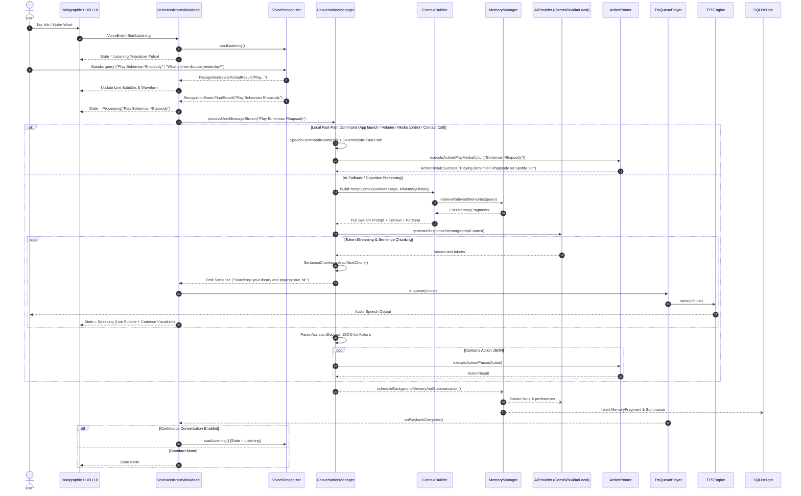
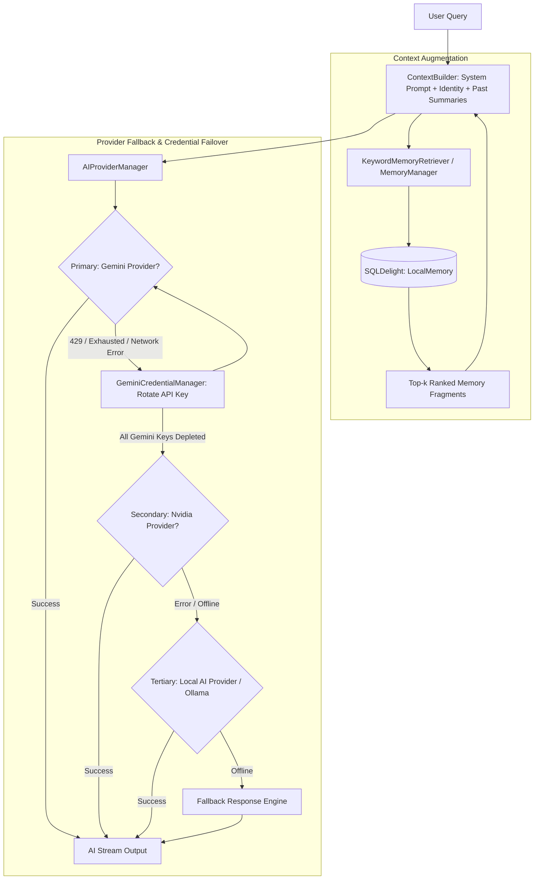
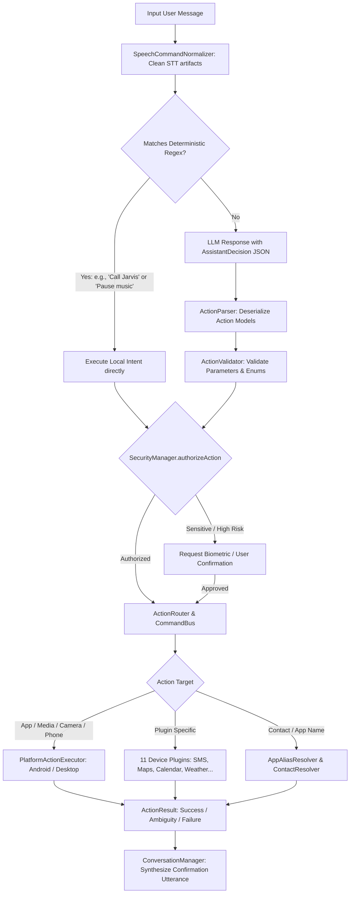
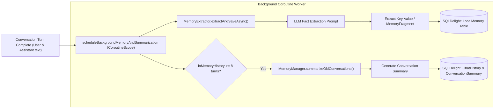
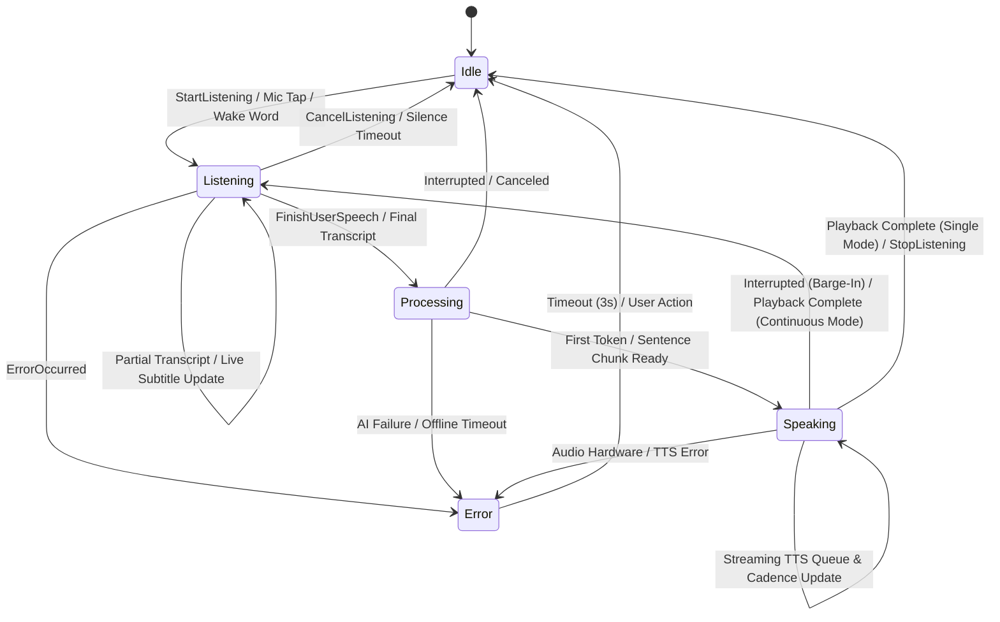
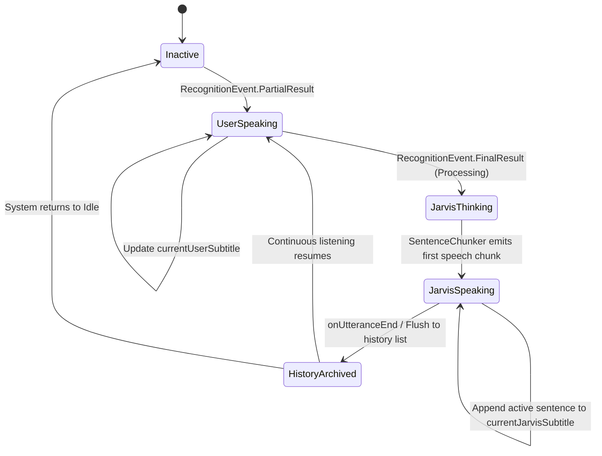

# Jarvis (Aura) — System Architecture & Flow Specification

Comprehensive technical flow and architectural blueprint for the **Jarvis (Aura)** Kotlin Multiplatform (KMP) voice AI assistant application across Android and Desktop platforms.

---

## 1. High-Level Architecture Overview

Jarvis (Aura) is structured around a **Reactive, Multi-Tier, Pipeline Architecture** built on Kotlin Multiplatform, Compose Multiplatform, Coroutines/Flow, Koin DI, and SQLDelight.



---

## 2. End-to-End User Interaction Flow



---

## 3. Core Subsystem Workflows

### 3.1 Voice & Real-Time Barge-In (Interruption) Pipeline

The voice loop operates a low-latency streaming pipeline that instantly cancels active AI generation and TTS playback when user speech or an explicit interruption is detected.

```mermaid
flowchart TD
    subgraph Listening_State ["1. Speech Ingestion"]
        MIC[Microphone Input] --> VAD[Voice Activity Detection / InterruptionMonitor]
        MIC --> REC[VoiceRecognizer: Google / Whisper / Native]
        REC -->|Partial Transcription| SUB_USER[Live User Subtitle Stream]
        REC -->|Final Transcript| ROUTER[Route to Conversation Manager]
    end

    subgraph Barge_In ["2. Real-Time Interruption System"]
        VAD -->|Voice Energy Detected during TTS| DETECT[InterruptionDetector]
        DETECT -->|Trigger Interrupted| CANCEL[Cancel activeAiStreamJob & ttsQueue.stop()]
        CANCEL --> RESET_STATE[Reset TTS / Switch to Listening State]
    end

    subgraph Speech_Generation ["3. TTS & Cadence Simulation"]
        ROUTER --> STREAM_AI[AI Provider Stream]
        STREAM_AI --> CHUNKER[SentenceChunker: Split by Punctuation]
        CHUNKER --> QUEUE[DefaultTtsQueuePlayer: Thread-safe Channel Queue]
        QUEUE --> ENGINE[TextToSpeechEngine: ElevenLabs/OpenAI/Azure/Google]
        QUEUE --> CADENCE[startSpeechCadenceSimulation: Sine-wave Amplitude Modulation]
        CADENCE --> VIS[AudioVisualizerController -> UI Hologram Topology]
    end
```

---

### 3.2 Cognitive Processing & Multi-Tier AI Provider Pipeline

The system incorporates dynamic provider selection, credential rotation, rate-limit failovers, and context augmentation.



---

### 3.3 Intent Parsing & Action Execution Architecture

Jarvis supports dual-path action dispatch:
1. **Deterministic Fast-Path**: Instant local execution without calling the LLM for common device intents (calling, SMS, media playback, apps, alarms).
2. **LLM Cognitive Path**: Structured JSON output format (`AssistantDecision`) parsed and executed via the `CommandBus` and `ActionRouter`.



---

### 3.4 Long-Term Memory & Asynchronous Extraction Flow

Jarvis extracts enduring facts, user preferences, and relationship aliases from everyday conversations in the background without blocking conversational replies.



---

## 4. State Machine Specifications

### 4.1 Voice Assistant State Machine (`VoiceAssistantState`)



---

### 4.2 Subtitle & Holographic HUD Feed State



---

## 5. Directory & Module Navigation

```
d:\Brainy\Jarvis\
├── androidApp/                       # Android native application entry point
│   └── src/main/kotlin/co/aura/android/
│       ├── AuraApplication.kt       # Application lifecycle & Koin Android startup
│       └── MainActivity.kt          # Edge-to-edge Compose entry & Intent handling
├── desktopApp/                       # Desktop JVM entry point
│   └── src/jvmMain/kotlin/co/aura/desktop/
│       └── Main.kt                  # Desktop Window configuration & Koin JVM startup
├── shared/                           # Core Kotlin Multiplatform (KMP) logic
│   ├── src/commonMain/kotlin/co/aura/
│   │   ├── actions/                  # Action parser, router, validator, command bus
│   │   ├── ai/                       # AI providers (Gemini pool, Nvidia, Local, OpenAI)
│   │   ├── automation/               # System automation manager
│   │   ├── backend/                  # Ktor HTTP client & Supabase integration
│   │   ├── communication/            # Contact resolver & alias logic
│   │   ├── conversation/             # ContextBuilder, PersonalityEngine, ConversationManager
│   │   ├── core/                     # Koin DI, DatabaseHelper, Logger
│   │   ├── data/                     # Repository implementations & DTOs
│   │   ├── domain/                   # Domain entities, models, and repository interfaces
│   │   ├── memory/                   # MemoryManager, KeywordMemoryRetriever, MemoryExtractor
│   │   ├── phone/                    # SystemControlProvider interface
│   │   ├── plugins/                  # 11 Device Plugins (SMS, Alarm, Music, Weather, etc.)
│   │   ├── presentation/             # Compose Multiplatform UI, ViewModels, Theme, HUD
│   │   ├── security/                 # SecurityManager, PermissionManager, SecureStorage
│   │   ├── sync/                     # SyncEngine for offline-first replication
│   │   ├── vision/                   # Visual intelligence provider
│   │   └── voice/                    # Speech recognizers, TTS engines, visualizer, barge-in
│   ├── src/commonMain/sqldelight/    # SQLite Schemas (ChatHistory, LocalMemory, SyncQueue)
│   ├── src/androidMain/              # Android platform implementations (TTS, STT, Actions)
│   └── src/desktopMain/              # Desktop JVM platform implementations
```
